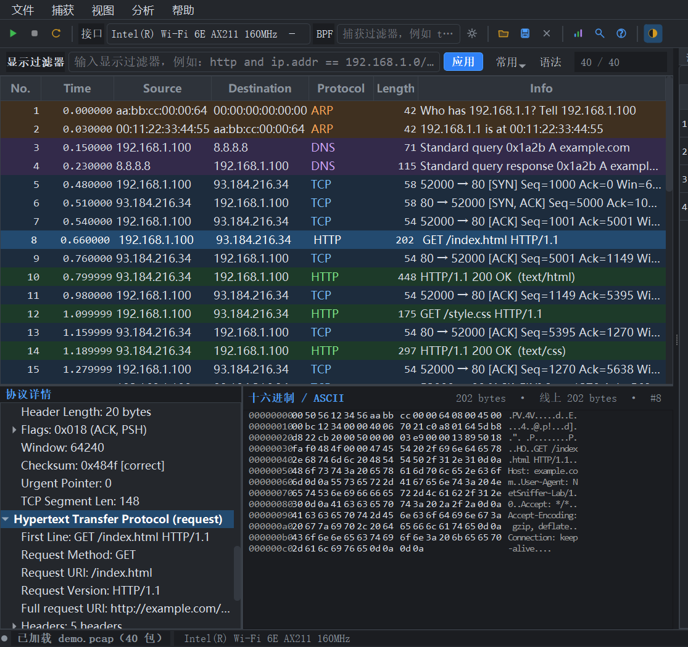

# NetSniffer 1A — 带 GUI 的网络嗅探器

《软件与系统安全》实验 1A：用 **Python 3 + PyQt5 + Npcap/libpcap** 实现一个带图形界面的网络嗅探器（NPS），
同时尽可能完善协议分析（NPA）、协议过滤、TCP 流追踪和进程归属。



## 功能一览

- **实时抓包**：Npcap `wpcap.dll`（libpcap 兼容 API）的 ctypes 绑定；网卡枚举、物理网卡优先排序、开始/停止/重捕获。
- **三窗格 GUI**：数据包列表、协议详情树、Hex/ASCII；选中字段在字节视图中高亮对应范围。
- **协议解析**：Ethernet/VLAN/ARP、IPv4/IPv6（含扩展头/分片）、TCP/UDP/ICMP/ICMPv6、HTTP/1.x、DNS、TLS（SNI/ALPN/版本）、
  DHCP、NTP、QUIC、SSH/FTP/SMTP/MQTT/Redis 等。
- **两级过滤**：BPF 捕获过滤（内核）+ 自研显示过滤器（and/or/not、括号、比较、`contains`/`matches`、CIDR、字段别名）。
- **TCP 流追踪**：四元组、方向判定、序列号重组（乱序/重传/缺口）、连接状态机、时序图、HTTP 事务还原。
- **进程归属（加分项）**：`GetExtendedTcpTable`/`GetExtendedUdpTable` + `QueryFullProcessImageNameW`；
  过滤 `proc.pid == N` / `proc.name == "python.exe"`。
- **统计**：协议分层、IPv4/IPv6/TCP/UDP 会话、吞吐量曲线。
- **pcap**：打开/保存经典 pcap；pcapng 回退到 `pcap_open_offline`；CSV 导出。
- **工程**：抓包/解析在 QThread，GUI 批量插入；有界队列与丢包计数；54 个 pytest 单元测试。

## 运行环境

- Windows 10/11
- Python 3.10+（开发使用 3.13.5）
- PyQt5 5.15.x
- **Npcap 1.60+**（安装时建议勾选 WinPcap API-compatible Mode）

> Npcap 是内核驱动，不能随 Python 程序一起打包；目标机器必须单独安装。

## 快速开始

```bat
python -m pip install -r requirements.txt
python main.py
```

或者：

```bat
setup_env.bat      :: 创建 .venv 并安装依赖
run.bat            :: 启动
run_demo.bat       :: 直接打开 samples\demo.pcap
run_tests.bat      :: 运行 54 个单元测试
```

打开示例捕获（无需网卡）：

```bat
python main.py --pcap samples\demo.pcap
```

真实回环演示（自动启动 `http.server`、抓取 `tcp port 8000` 并生成截图）：

```bat
python tools\live_demo.py
```

生成示例 pcap、报告截图、图表和报告：

```bat
python tools\make_demo_pcap.py
python tools\make_screenshots.py
python tools\make_diagrams.py
python tools\make_report.py
python tools\make_video.py --ffmpeg "C:\path\to\ffmpeg.exe"
```

## Npcap 路径

程序按以下顺序寻找 `wpcap.dll`：

1. 环境变量 `NETSNIFF_WPCAP` / `NPCAP_DLL`
2. 源码目录 `config.json` 的 `wpcap_path`
3. 注册表 `HKLM\SOFTWARE\WOW6432Node\Npcap\InstallDir`
4. `C:\Windows\System32\Npcap`、`System32`、`SysWOW64`、`Program Files\Npcap` 等标准位置
5. 源码目录 `vendor\wpcap.dll`

如果 Npcap 装在非标准目录，可复制 `config.example.json` 为 `config.json` 并填写：

```json
{ "wpcap_path": "C:\\Program Files\\Npcap\\wpcap.dll" }
```

`config.json` 已在 `.gitignore` 中，不会被提交。

## 显示过滤器

| 示例 | 含义 |
| --- | --- |
| `http` | 只看 HTTP |
| `tcp.port == 443` | TCP 443 |
| `ip.addr == 192.168.1.0/24` | 网段匹配 |
| `http.response.code >= 400` | HTTP 错误响应 |
| `http.host contains "example"` | Host 包含 example |
| `http.request.uri matches "^/api/"` | URI 正则 |
| `tcp.flags.syn == 1 and not tcp.flags.ack == 1` | SYN 请求 |
| `tls.sni contains "example"` | SNI 包含 example |
| `tcp contains "GET "` | TCP 载荷包含 GET |
| `proc.name == "python.exe"` | 按进程过滤 |
| `tcp.stream == 3` | 只看第 3 条 TCP 流 |

完整字段与语法见程序“语法”按钮（F1）或报告第 5 章。

## 项目结构

```text
netsniff/
  capture/    npcap.py（ctypes 绑定）、worker.py（QThread）、pcapfile.py
  dissect/    core + ethernet/arp/ip/tcp/udp/icmp/dns/http/tls/app
  filters/    display.py（词法/语法/AST/闭包）
  analysis/   streams.py、processes.py、stats.py
  ui/         main_window.py、三窗格、流对话框、统计、主题
tests/        54 个 pytest 用例与构包器
tools/        示例 pcap、截图、图表、报告生成
samples/      demo.pcap（40 包）、live_loopback.pcap（130 包）
docs/         报告图片、图表
```

## 测试结果

```text
$ python -m pytest
54 passed in 0.25s
```

真实回环抓包：130 个包、10 条 TCP 流、13760 字节；TCP 100、HTTP 30；10 条流全部归属 python.exe；
0 个专家错误、0 个驱动/界面丢包。

## 已知限制

- TLS 只解析握手元数据，不解密 HTTP/2/QUIC 载荷。
- IP 分片不做完整重组；802.11 只解析到 MAC 层。
- Python 解析在 1 Gbps 以上可能成为瓶颈；本实现定位教学与中小流量分析。
- 抓包可能包含敏感信息，请仅在授权环境中使用。

## 报告、视频与 Git

- 实验报告：`../李柏谚_202649210129022_ex1A_report.docx` / `.pdf`（35 页）
- 演示视频：`../李柏谚_202649210129022_ex1A_play.mp4`（30 秒，1600×900，H.264，中文字幕）
- 代码仓库：https://github.com/LiLisyn123/software-system-security-experiments

## 致谢

课程：中国科学院大学《软件与系统安全》（刘鹏老师）。
参考：libpcap、Npcap、Wireshark Display Filter Reference、RFC 9110/1035/9293/8446/8200、
Microsoft Learn（GetExtendedTcpTable）以及 PyQt5 文档。
